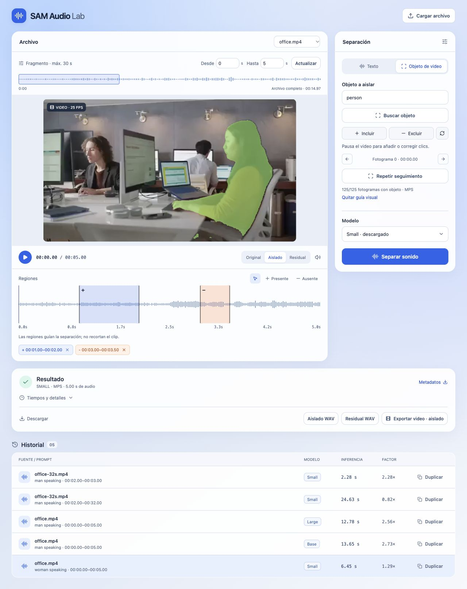
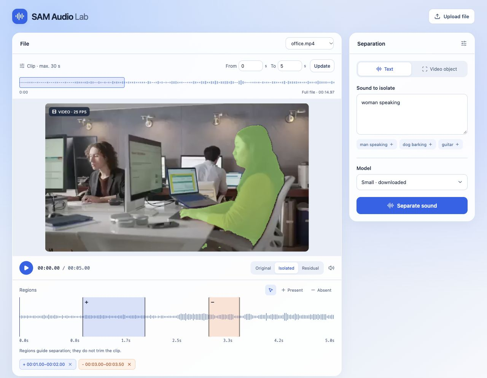
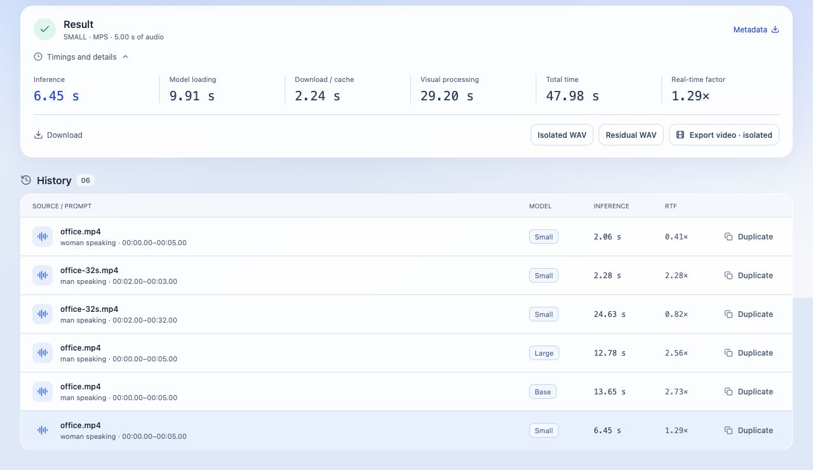

<h1 align="center">SAM Audio Lab</h1>

<p align="center">
  Separate sounds from audio and video using text, regions, and objects.<br>
  Local web interface · SAM Audio Small, Base, and Large · SAM 3 visual prompts
</p>

<p align="center">
  <a href="https://github.com/jrterven/sam-audio-lab/actions/workflows/ci.yaml"></a>
  <a href="LICENSE"></a>
  <a href="docs/INSTALLATION.md"></a>
  <a href="docs/INSTALLATION.md#linux"></a>
</p>

<p align="center">
  <a href="#install">Install</a> ·
  <a href="#run-the-app">Run</a> ·
  <a href="#screenshots">Screenshots</a> ·
  <a href="#first-run">Usage</a> ·
  <a href="docs/TROUBLESHOOTING.md">Help</a> ·
  <a href="#credits-and-license">License</a>
</p>



<p align="center"><sub>Actual app screenshot using the sample video: SAM 3 mask, object tracking, and temporal regions.</sub></p>

## Features

- **Text prompts:** `man speaking`, `dog barking`, `guitar`, or your own description.
- **Temporal regions:** draw, move, and resize intervals where the sound is
  present (+) or absent (−). These guide separation; the output clip is set separately.
- **Video objects:** find objects by text, select an instance, add positive or
  negative clicks, and refine tracking on other frames.
- **Model comparison:** choose Small, Base, or Large. Duplicate a run from the
  history to reuse its inputs with another model.
- **Synchronized playback:** switch between Original, Isolated, and Residual
  without losing your position. Export WAV or an MP4 clip with the selected track.
- **Persistent history:** keep prompts, masks, model, seed, revisions, and timings.
  Cancel jobs and retry interrupted runs.

Media is processed on your computer. Internet access is needed to install
packages and download models from Hugging Face; uploaded files are not sent to
an inference service. The server listens only on `127.0.0.1`.

## Screenshots

<details>
<summary><strong>Text and regions</strong> · describe the sound and mark where it occurs</summary>



Combine text, temporal regions, and a visual guide in the same run.
The upper clip controls set the output duration; the lower regions mark
where the target sound is present or absent.

</details>

<details open>
<summary><strong>Results and history</strong> · listen, compare, and export</summary>



The timings shown come from actual runs using `office.mp4` and a repeated copy
of that sample for the 30-second test. They are not a controlled benchmark.

</details>

## Platforms

| System | Runtime | Validation status |
| --- | --- | --- |
| macOS with Apple Silicon | Metal / MPS, float32 | Small, Base, Large, and SAM 3 visual tested on an M4 Max with 128 GB |
| Linux | NVIDIA CUDA when detected by PyTorch; CPU fallback | Installation documented; GPU inference not yet validated on Linux hardware |
| Windows 11 / Windows 10 with WSL2 support | Ubuntu inside WSL2; CUDA or CPU | Installation documented; not yet validated on Windows |
| Intel Mac | CPU, subject to package availability | Not validated; not the recommended platform |

**Native Windows is not supported by the current process supervisor. Use WSL2.**
There is no established minimum RAM/VRAM requirement across all platforms.
Start with Small and a 5-second clip. The audio checkpoints take approximately
4.75 GiB (Small), 7.19 GiB (Base), and 13.84 GiB (Large), excluding encoders,
SAM 3, and the Python environments.

## Install

You need Git, Conda (Miniforge, Miniconda, or Anaconda), Node.js 22.12+ with npm,
FFmpeg, and a Hugging Face account with approved access to the models.

```bash
git clone https://github.com/jrterven/sam-audio-lab.git
cd sam-audio-lab
```

Follow the installation guide for your system. The detailed guides linked below
are currently in Spanish; their commands can be copied as written.

| macOS | Linux | Windows |
| :---: | :---: | :---: |
| [Apple Silicon / Metal](docs/INSTALLATION.md#macos-con-apple-silicon) | [NVIDIA CUDA or CPU](docs/INSTALLATION.md#linux) | [Ubuntu in WSL2](docs/INSTALLATION.md#windows-con-wsl2) |

The guide creates two separate environments: **`sam3`** for audio and the API
(Python 3.11, Transformers 4), and **`sam3-vision`** for visual segmentation
(Python 3.12, Transformers 5). Do not combine them. The vision environment is
optional for text and temporal prompts.

Request access to [SAM Audio Small](https://huggingface.co/facebook/sam-audio-small),
[Base](https://huggingface.co/facebook/sam-audio-base),
[Large](https://huggingface.co/facebook/sam-audio-large), and
[SAM 3](https://huggingface.co/facebook/sam3) as needed. SAM Audio access does
not automatically grant SAM 3 access. Sign in with `hf auth login` from your
installed environment and enter your token only in the terminal prompt.

## Run the app

After installation, run these commands from the repository root:

```bash
conda activate sam3
python -m lab.doctor
python run_lab.py
```

Open **[127.0.0.1:8765](http://127.0.0.1:8765/)**. Stop the server with `Ctrl+C`
in the terminal. You can also launch it without activating the environment:

```bash
conda run --no-capture-output -n sam3 python run_lab.py
```

Use `python run_lab.py --build` to rebuild the interface, or `--port 8766` to
choose another port. Models download on first use. The dropdown shows whether
the checkpoint is cached; its encoders may still need to be downloaded.

## First run

1. Click **Use sample video** to load `office.mp4`, or **Upload file** to use your own media.
2. Set **From** to 0 and **To** to 5, then click **Prepare clip**.
3. In **Text**, enter `man speaking`, choose **Small**, and click **Separate sound**.
4. Switch between **Original**, **Isolated**, and **Residual**, then download a WAV.
5. Click **Duplicate** in the history and select Base or Large to compare.

**Play** is available as soon as the upload finishes. Before preparing a clip,
it plays the full original file; the waveform lets you seek through it. After
preparing a clip or opening a result, playback uses that clip's time range.
Switching **Original**, **Isolated**, and **Residual** keeps your position and
continues playback if it was playing. Pressing **Play** at the end starts again.

For temporal prompts, select **Present** or **Absent**, then drag on the waveform.
Move or resize a region to adjust it, or use its × button to delete it. The
regions do not change the clip boundaries.

For visual prompts, open **Video object**, enter `person`, and click **Find object**.
Choose a candidate with **Select**, or use **Include** and **Exclude** to mark
points on the paused video. Click **Track object in clip** and review the mask
before separating. To correct tracking, pause at another frame, add clicks,
and track again. Keep a text prompt and regions if you want to combine all three
forms of guidance.

Expand **Timings and details** to inspect a run. **Export video** uses the Isolated
or Residual track selected in the player (Isolated when Original is selected).
The completed export appears as **Download MP4**.

## Limits and measured results

Long files are supported by processing clips of **up to 30 seconds**. Each run
separates one source or object with mono 48 kHz audio, float32 precision, seed 42,
and one separation candidate. Automatic region prediction and reranking are
not included. A visual mask guides separation; it does not guarantee perfect isolation.

Individual measurements on an M4 Max with 128 GB (October 9, 2026):

| Test | Clip | Audio separation |
| --- | ---: | ---: |
| Small, text + regions + object | 5 s | 6.45 s |
| Base, text | 5 s | 13.65 s |
| Large, text | 5 s | 12.78 s |
| Small, text + regions, starting at second 2 | 30 s | 24.63 s |

These measurements are not a controlled benchmark or a quality evaluation.
Tracking the 5-second video took **an additional 379.53 s**, and the audio model's
visual encoder took 29.20 s. The real-time factor (RTF) is audio separation time
divided by clip duration; it excludes the other stages.
[Validation notes (Spanish)](LAB.md#validación-realizada-en-esta-mac).

## Data and documentation

Projects, media, and results are stored in `.lab-data/`; checkpoints use the
Hugging Face cache. Neither is committed to Git. To back up your history, stop
the server and copy the **entire** `.lab-data/` directory.

The detailed project guides are currently in Spanish:

- [Installation, credentials, and configuration](docs/INSTALLATION.md)
- [Usage, timings, and real inference validation](LAB.md)
- [Diagnostics and troubleshooting](docs/TROUBLESHOOTING.md)
- [API, processes, and storage](docs/ARCHITECTURE.md)
- [Contributing and running tests](CONTRIBUTING.md)
- [Original Mac environment notes](MACOS.md)

The [original SAM Audio documentation](docs/upstream/README.md) is available in English.

## Credits and license

SAM Audio Lab is an independent adaptation maintained by
[Juan Terven](https://github.com/jrterven), not an official Meta application.
It is based on [facebookresearch/sam-audio](https://github.com/facebookresearch/sam-audio),
commit `bb4c6999d2677c7402360e426afc01ddfad6dce0`, and preserves its history and notices.

The derived code and Lab contributions are distributed under Meta's original
**[SAM License](LICENSE)**, preserved without changes. **SAM 3 also uses SAM
License**: an [official copy](licenses/SAM3-LICENSE) and its
[source revision](licenses/README.md) are included.

The SAM 3 implementation in Transformers, Perception Encoder, and DACVAE have
their own licenses, which do not replace the licenses of Meta's models.
Model weights are downloaded from the official Hugging Face repositories and
are not redistributed here. See **[NOTICE.md](NOTICE.md)** (Spanish) for
attribution, component license scope, and redistribution conditions; the
included license texts are in English.
