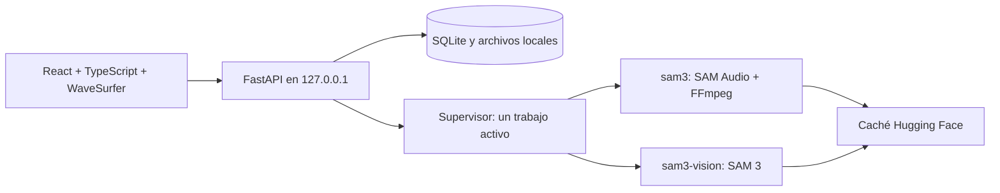

# Arquitectura y API

## Componentes

`run_lab.py` sirve la compilación Vite desde FastAPI. El supervisor en `lab/jobs.py`
procesa una cola; solo un trabajador está activo. Audio y visión usan intérpretes
separados para mantener Transformers 4 y 5 aislados.

El proceso de audio puede reutilizar un modelo entre separaciones del mismo
tamaño. Cambiar de tamaño libera sus referencias; pasar a visión termina el
proceso de audio y viceversa. Cancelar detiene el grupo POSIX del trabajador,
incluidos FFmpeg y sus descendientes. Esta es la razón para usar WSL2 en Windows.

La selección de dispositivo es CUDA → MPS → CPU. `SAM_LAB_DEVICE` permite forzar
uno. Los modelos usan float32. Una operación visual no soportada en Metal se
reintenta en CPU; un error de memoria se reporta y permite otra ejecución.

## Organización

| Ruta | Responsabilidad |
| --- | --- |
| `lab/api.py` | API, archivos permitidos, SSE y frontend estático |
| `lab/schemas.py` | Validación de recortes, regiones, clics y exportación |
| `lab/jobs.py` / `worker.py` | Cola, cancelación, protocolo JSON e inferencia de audio |
| `lab/vision.py` | Detección textual, seguimiento y corrección de máscaras |
| `lab/media.py` | FFmpeg, inspección, recortes, proxies y exportaciones |
| `lab/store.py` | Persistencia SQLite con WAL |
| `lab/config.py` / `device.py` | Rutas portables y dispositivo |
| `lab/doctor.py` | Diagnóstico de instalación sin descargar pesos |
| `web/src/` | Interfaz, reproducción, forma de onda y regiones |
| `sam_audio/` | Código de Meta con ajustes para imports y memoria |
| `tests/` | Pruebas sin pesos y pruebas opcionales de inferencia real |

## Tiempo, coordenadas y máscaras

Los recortes conservan un inicio/fin absoluto dentro del medio. Las regiones
también se guardan en segundos absolutos; al inferir se resta el inicio del
recorte. Una región positiva no cambia la longitud de salida.

El proxy de video tiene 25 fps y hasta 1280 píxeles de ancho. Clics normalizados
entre 0 y 1 se transforman a la resolución real del proxy. Las anotaciones usan
índices de fotograma relativos al recorte. Las máscaras guardadas tienen forma
`[fotogramas, alto, ancho]`; los pasos de 40 ms se alinean con el códec de audio.
No se puede reutilizar un seguimiento de otro medio o recorte.

La polaridad sigue `SAMAudioProcessor.mask_videos`: los píxeles del objeto
seleccionado se ponen a cero antes del encoder visual. Este encoder trabaja en
lotes de ocho fotogramas para limitar memoria. La exportación recorta el video
original y reemplaza su pista de audio; no exporta la máscara dibujada.

SAM 3 se carga con las clases oficiales y verifica que no falten pesos. La
adaptación de correcciones se aplica después de cargar, conservando los logits
anteriores. Una corrección exclusivamente negativa agrega una referencia positiva
dentro de la máscara previa para preservar el objeto. Cambios de Transformers
requieren repetir la regresión visual real.

## Persistencia

SQLite almacena medios, borradores y trabajos como registros JSON. Cada trabajo
guarda una copia de su entrada; editar el borrador no altera ejecuciones previas.
Los resultados incluyen modelo, revisión, semilla, tiempos y referencias a medios
y máscaras inmutables. Al reiniciar, trabajos incompletos pasan a `interrupted`.

`.lab-data/` contiene medios originales, recortes, proxies, máscaras NumPy,
resultados WAV/MP4, metadatos, SQLite y logs. Está excluida de Git. La API no
publica la base de datos ni los logs; permite únicamente categorías de archivos
de medios/resultados y comprueba que las rutas permanezcan dentro del directorio.

## API local

`GET /api/media/{media_id}/audio` reproduce el audio original completo sin crear
un recorte ni iniciar inferencia. Convierte el archivo a un MP3 compatible con
el navegador y lo conserva en `media/{id}/preview.mp3`; admite solicitudes Range
para buscar posiciones. El archivo subido se conserva intacto. El reproductor
distingue el tiempo del archivo completo del tiempo relativo de un clip y
mantiene posición y estado de reproducción al cambiar entre las pistas del resultado.

Con el servidor activo, consulta **http://127.0.0.1:8765/docs** para el contrato
OpenAPI completo y los esquemas de cada petición.

| Endpoint | Uso |
| --- | --- |
| `GET /api/state` | Medios, proyectos e historial |
| `GET /api/models` | Checkpoints en caché y existencia del entorno visual |
| `POST /api/media` | Carga multipart de audio/video |
| `POST /api/example` | Importa el ejemplo incluido |
| `POST /api/clips` | Prepara un recorte y su proxy |
| `PUT /api/projects/{id}` | Guarda el borrador; se consulta mediante `/api/state` |
| `POST /api/vision/detect` | Máscaras candidatas por texto |
| `POST /api/vision/track` | Seguimiento con clics, máscara o correcciones |
| `POST /api/separate` | Ejecuta el modelo seleccionado |
| `GET /api/jobs/{id}` | Estado y resultado de un trabajo |
| `POST /api/jobs/{id}/cancel` | Solicita cancelación |
| `GET /api/events` | Eventos SSE de estado |
| `POST /api/exports` | Crea MP4 con pista aislada/residual |
| `GET /api/files/{path}` | Medios y resultados permitidos; admite rangos |
| `GET /api/masks/{job_id}/{frame}.png` | Máscara de un fotograma para la superposición |

El servidor se limita a loopback y valida Host/Origin local. No implementa
cuentas, autenticación multiusuario ni despliegue público. No cambies el bind a
`0.0.0.0` sin diseñar esas protecciones.

## Diferencias respecto al código original

Se difieren imports de Judge, CLAP, ImageBind y predicción de regiones; se evita
abrir contexto cuDNN para tensores que no usan CUDA; el encoder visual mueve
lotes pequeños al dispositivo. El Lab desactiva reranking y regiones automáticas.
Los notebooks y evaluaciones upstream se conservan como referencia, pero sus
dependencias completas y flujos no forman parte de esta instalación del Lab.
